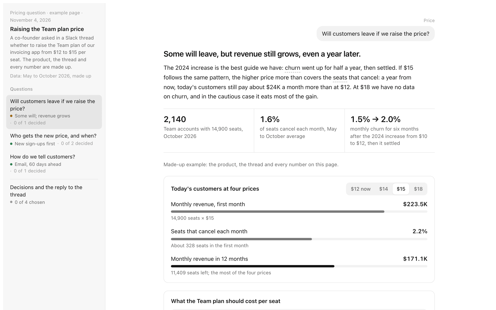
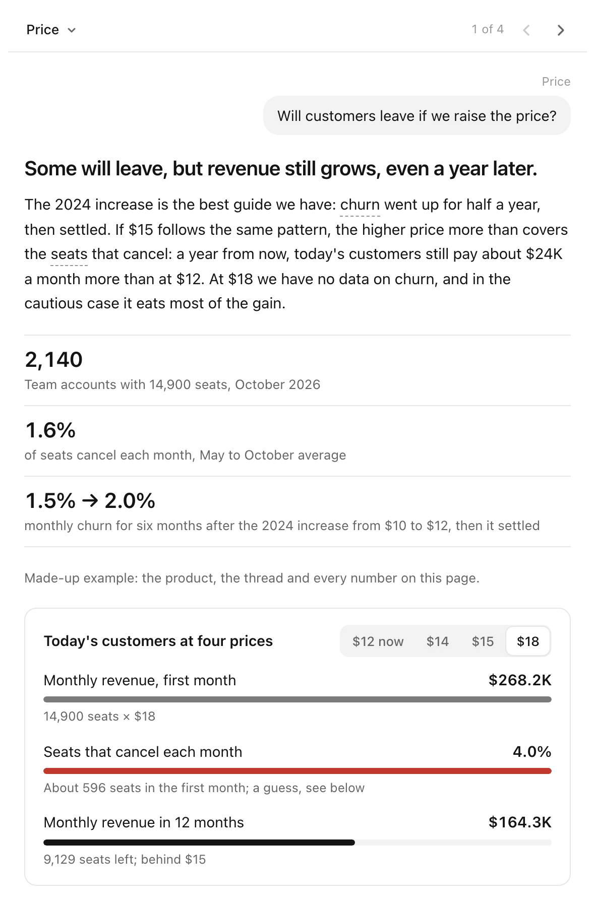
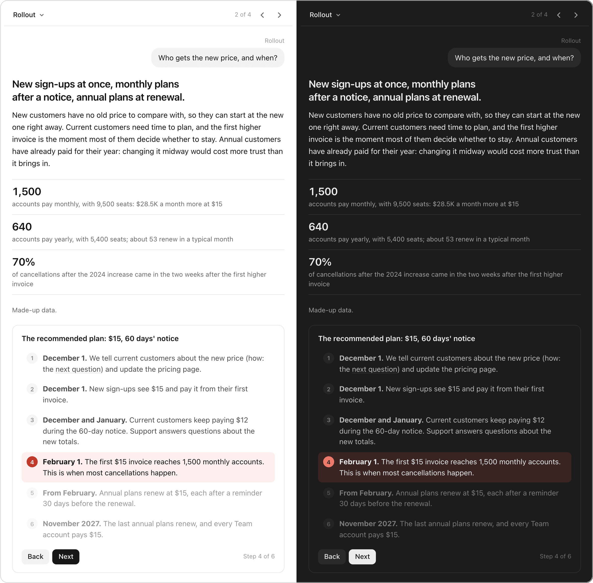
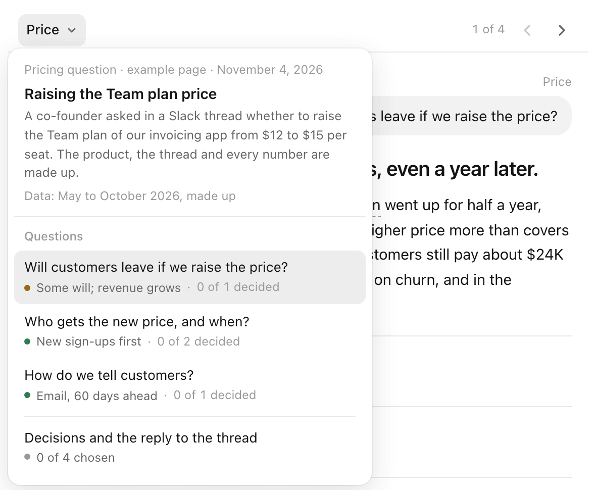
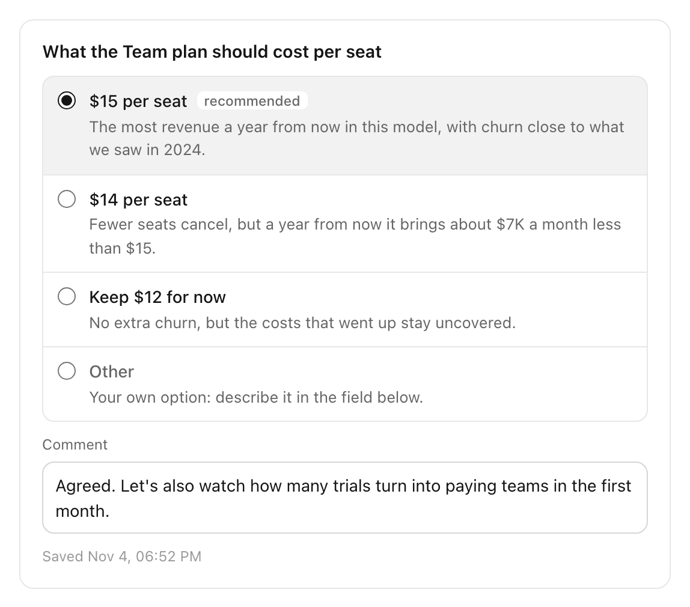
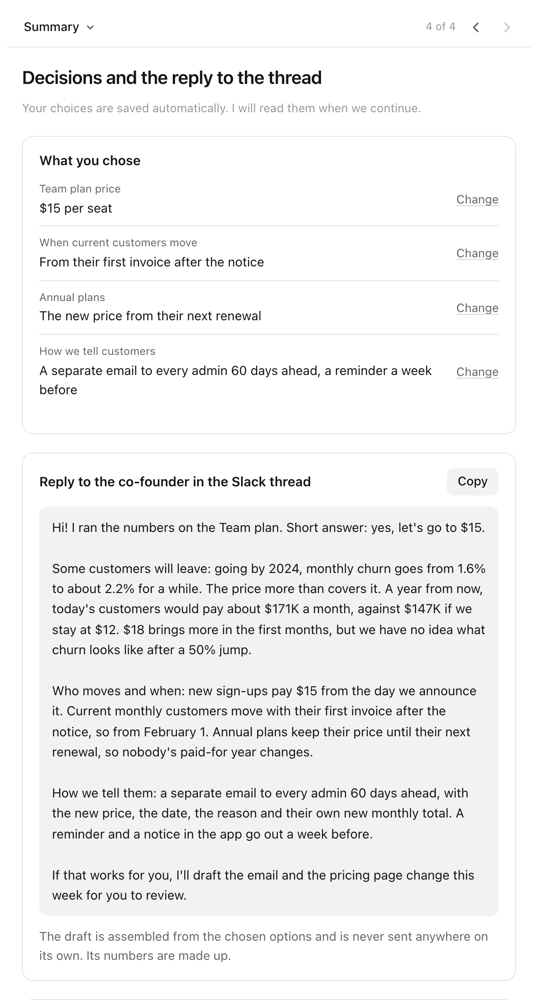

# decision-page

**A richer way to talk with Claude.** A long chat answer becomes an interactive page next to the chat. It works like a presentation you answer:
- one question per screen, the answer first;
- visuals and scenarios to play with;
- options with their consequences, your choices saved as you go.

Claude reads your choices back and continues. At the end it assembles the result: a plan, a list, or a reply to send.

It works for any topic: a trip, a dinner for six, what laptop to buy, how a concept works, a design review, an incident, a product funnel with millions of users. It is what talking to an agent in the Claude desktop app could feel like, built today as a skill.

<!-- DEMO VIDEO -->

<picture><source media="(prefers-color-scheme: dark)" srcset="docs/page-wide-dark.png"></picture>

*The bundled example: a co-founder asks in a Slack thread whether to raise the Team plan of a B2B invoicing app from $12 to $15 per seat. The product, the thread and all data on the page are made up.*

## Install

**Send the link to this page to Claude and ask it to install the skill.** Use the Code tab of the Claude desktop app, or Claude Code. Claude does the rest, and you don't need a terminal.

### Instructions for the AI agent installing this skill

1. **Download the installer, read it, and run it.** It needs only `curl` and `tar`.

   ```sh
   curl -fsSLo /tmp/decision-page-install.sh https://raw.githubusercontent.com/karambirov/decision-page/main/install.sh
   sh /tmp/decision-page-install.sh
   ```

   What it does:
   - **Skill folders.** It copies `decision-page` into `~/.claude/skills`, then each of the eight skills it relies on that the person does not have yet, from its author's repository. Set `CLAUDE_SKILLS_DIR` to use another folder.
   - **Scenes.** When Node.js 20.19 or newer is present, it runs `npm install` in the `stageshow` folder. That takes about 110 MB, plus the npm cache.
   - **Skills the person already has** are left alone, whatever way they were installed: a folder, a link, a git checkout or a plugin.
   - **Nothing else changes:** no system packages, no settings. The download is about 2 MB.
2. **Read the last lines it prints and act on them:**
   - **"Check: the example page builds"** means the install works.
   - **"Python 3: MISSING".** Pages can't be built without Python 3. On a Mac, ask the person first, then run `xcode-select --install` and tell them to click **Install** in the window that opens. When it finishes, run step 1 again.
   - **"Check FAILED".** Run the command it prints, then fix what the error shows.
   - **"Animated scenes: off".** Node.js is missing or older than 20.19. This is optional: pages work without animated scenes. Offer to install Node.js from [nodejs.org](https://nodejs.org) only if the person wants scenes.
3. **Tell the person to start a new chat,** so Claude picks up the skills. Give them an example request from [How to use it](#how-to-use-it), in their language.

**Update.** Run step 1 again: it updates `decision-page` and adds any helper skill that is still missing. It is safe to repeat, including after a run that stopped with an error.

**Remove.** Delete these folders from `~/.claude/skills`, but only the ones whose folder has an `.installed-by-decision-page` file: the others were there before.
- `decision-page`, `stageshow`, `apple-design`, `emil-design-eng`;
- `web-design-guidelines`, `ios-design-guidelines`, `android-design-guidelines`;
- `redaktura`, `statya`.

**Windows.** The script does not run there, so do the same by hand:
1. For each row of [What gets installed](#what-gets-installed), download the repository and copy the listed folder into `%USERPROFILE%\.claude\skills`, renamed to the skill name. For example, `skills/web` becomes `web-design-guidelines`.
2. If Node.js 20.19+ is installed, run `npm install` in the `stageshow` folder.
3. Pages need Python 3 from [python.org](https://www.python.org/downloads/).

**skills CLI.** If you prefer the [skills CLI](https://skills.sh), `npx skills add karambirov/decision-page -g -a claude-code -y` installs this skill alone. Run the installer above as well to get the helper skills.

## Is it for you

It is for anyone who uses the Claude desktop app and works through things with it. In a chat, Claude answers with text and the occasional table. When the answer is several screens long, holds three choices and leans on sources, reading it is hard and answering it is harder. A page makes the same conversation visual and interactive. It is just as useful to a designer, a developer on call, a product manager, a student or someone planning a family holiday.

The skill keeps the chat for what fits there and moves the rest to a page:

| Stays in the chat | Goes to a page |
|---|---|
| one question or clarification | two or more linked choices |
| a choice between two or three options without long explanations | options whose consequences need to be shown |
| an answer that fits in a couple of paragraphs | a lot to take in: sources, prices, data, code, logs |
| a status update, a short report | something clearer shown than told: how a thing works, a timeline, a screen's behavior |
| | a result assembled from your choices: a plan, a list, a reply |

It is not for one-off questions, writing documents or making slides.

## How to use it

Ask Claude in your own words. The skill starts when there are choices to make or a lot to take in. For example:

- *"Plan a four-day trip to Lisbon in March for two adults and a toddler."*
- *"I'm choosing between these three laptops for video editing. Help me decide."*
- *"Six guests on Saturday, one vegan and one gluten-free. Help me plan the menu."*
- *"Explain how HTTPS works, step by step, with something I can click through."*
- *"Here are two homepage designs. Walk me through the trade-offs."*
- *"Review this incident and help me decide what to do about it."*
- *"Our checkout conversion dropped last week. Figure out why and what to do."*
- *«Помоги выбрать квартиру из этих трёх»* (pages work in Russian too).

Claude looks things up first, then builds the page and opens it next to the chat. You pick options and write comments; the page saves them as you go. Tell Claude in the chat when you are done. Claude reads your choices, replies briefly and continues; a new round of the page comes only when several decisions pile up again. Nothing is sent on your behalf: the reply on the page can only be copied.

## What a page looks like

The page is built for the Claude desktop side panel, about 590 px wide. Each screen holds one question. First comes the question as it was asked, then the answer, then up to three key facts and one interactive visual. Details sit one tap deeper. Light and dark themes both work.

<picture><source media="(prefers-color-scheme: dark)" srcset="docs/page-narrow-dark.png"></picture>




In a narrow panel, the question menu opens from the top bar, and arrows move between questions. Each item shows the verdict and how many of its decisions are made. Wider than 1000 px, the menu stays on the left, as in the first screenshot.

<picture><source media="(prefers-color-scheme: dark)" srcset="docs/question-switcher-dark.png"></picture>

A decision has mutually exclusive options, each with a one-line consequence. One option is marked as recommended. There is always an "Other" option for your own answer and a comment field, and the choice saves by itself.

<picture><source media="(prefers-color-scheme: dark)" srcset="docs/decision-dark.png"></picture>

The last item is the summary. It lists what you chose and gives a reply draft built from those choices, with a copy button. It also lists what Claude did not check and the sources.

<picture><source media="(prefers-color-scheme: dark)" srcset="docs/reply-draft-dark.png"></picture>

When UI behavior is easier to show than to describe, a question can carry an animated scene. In the bundled example, a survey is closed, the checkout button stops working, and every tap adds an event to the error tracker.


Other visuals in the template:
- a signal path with "now / after the fix" modes;
- a situation switcher;
- a step-through;
- try-it-yourself queries;
- bars, a two-column comparison and charts.

The catalog is in [references/components.md](references/components.md). Claude writes the page in the reader's language. The page's own buttons and labels come in English and Russian.

## Requirements

- **Claude Code in the Claude desktop app or on claude.ai** gives the full experience. The page is published as a private artifact in your account and opens next to the chat. Choices are saved in the page, and Claude reads them back.
- **Claude Code in a terminal** also works, with less. The page is a local file opened in a browser. Choices stay in the browser, and you hand them to Claude with a copy button.
- **Python 3** builds the pages. It uses only the standard library.
- **Node.js 20.19 or newer** is optional. It builds animated scenes. Without it, Claude uses a step-through or a situation switcher instead.

## What gets installed

`install.sh` downloads each skill from its author's repository and copies the folder into `~/.claude/skills`. Pages build without the helper skills, but new widgets, scenes and texts come out worse.

| Skill | Source repository and folder | What it adds |
|---|---|---|
| `decision-page` | [karambirov/decision-page](https://github.com/karambirov/decision-page) | this skill |
| `stageshow` | [benjitaylor/skills](https://github.com/benjitaylor/skills), `stageshow/` | animated interface scenes; `npm install` runs in its folder when Node.js is present |
| `apple-design`, `emil-design-eng` | [emilkowalski/skill](https://github.com/emilkowalski/skill), `skills/apple-design/`, `skills/emil-design-eng/` | motion, presses, step-by-step reveal |
| `web-design-guidelines`, `ios-design-guidelines`, `android-design-guidelines` | [ehmo/platform-design-skills](https://github.com/ehmo/platform-design-skills), `skills/web/`, `skills/ios/`, `skills/android/` | accessibility, layout, platform behavior when a proposal changes an app screen |
| `redaktura`, `statya` | [N1arko/redaktura-skills](https://github.com/N1arko/redaktura-skills), `redaktura/`, `statya/` | structure and editing of Russian text |

The page also uses `artifact-design`, `artifact-capabilities`, `artifact-diagramming` and `dataviz`, which come with Claude Code.

## Privacy

- **Published pages.** A page is published as a private artifact in your own Claude account. Only you can see it until you share it.
- **Messages.** Claude never sends messages, creates tasks or changes services on your behalf without your explicit "yes" to the exact text.
- **Install telemetry.** `install.sh` only downloads: from GitHub, and from npm for scenes. It reports nothing. The skills CLI reports installs of public repositories to skills.sh; to turn that off, prefix `npx` commands with `DISABLE_TELEMETRY=1`.

## How it works

Claude writes a content file, not a whole page. The content file holds:
- the sidebar with the questions;
- one section per question;
- a glossary;
- a `composeReply` function that turns the choices into the reply draft.

`scripts/build.py` merges it with `assets/template.html`, which holds the styles, navigation, widgets and storage. The script checks the markup and writes two files: `page.html` for publishing and `preview.html` for a local browser. Scenes are bundled separately by `scripts/build-scene.mjs`, then inlined by the same build.

To build the example yourself, run this from the skill folder and open `preview.html` in a browser:

```sh
python3 scripts/build.py examples/pages/team-pricing.en.content.html --out /tmp/decision-page-example
```

## Repository layout

```
install.sh                installs this skill and the skills it relies on
SKILL.md                  instructions for Claude: chat or page, workflow, rules
assets/template.html      page template: Claude desktop look, navigation, widgets, storage, reply
scripts/build.py          checks a page and assembles it from a content file and the template
scripts/build-scene.mjs   bundles a stageshow scene into one script for embedding
references/               modes, widgets, visuals, language, proposal checklist, decision loop, pitfalls, dependencies
examples/pages/           example content file in English and Russian, made-up data: raising a Team plan price
examples/scenes/          example scene: a checkout button that stops working
docs/                     screenshots for this README
```

Changing the skill: see [CONTRIBUTING.md](CONTRIBUTING.md).

## License

MIT, see [LICENSE](LICENSE).
