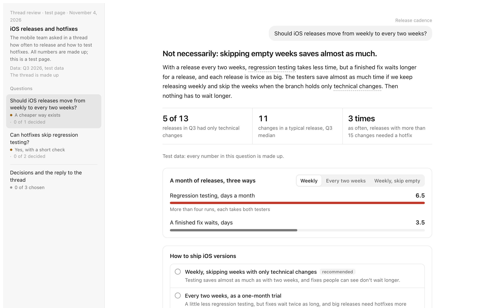
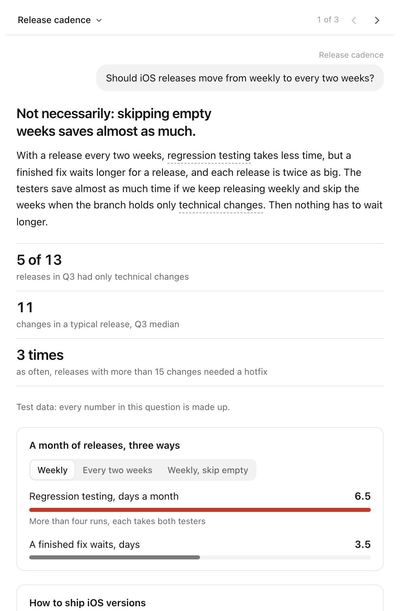
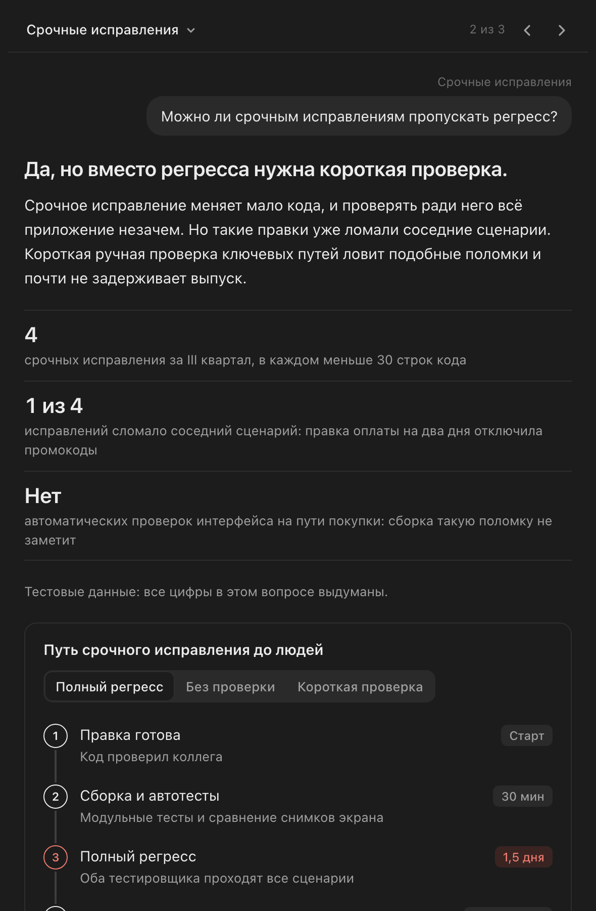
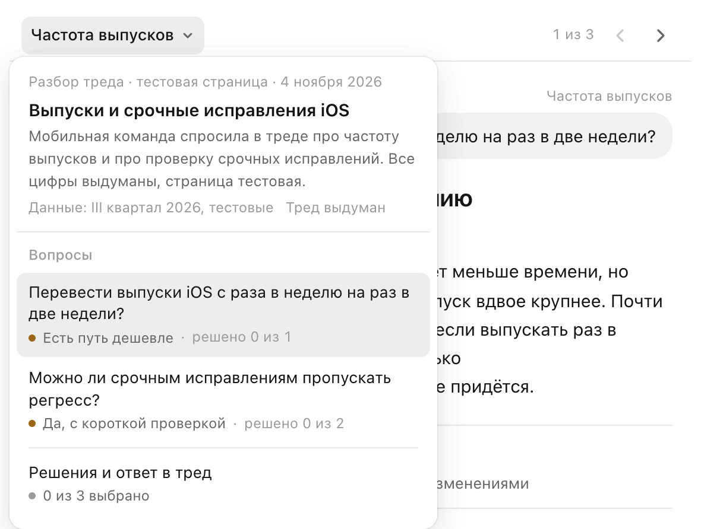
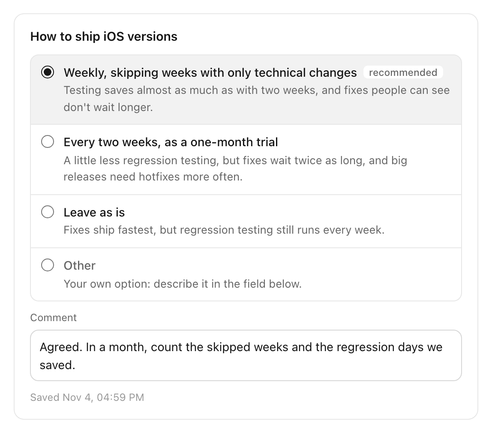
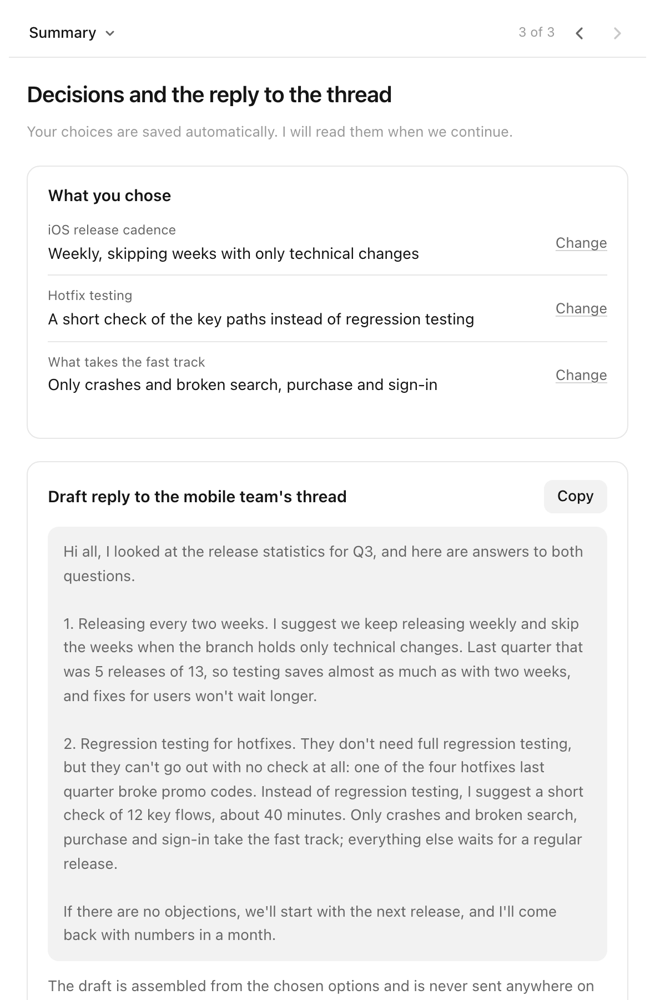
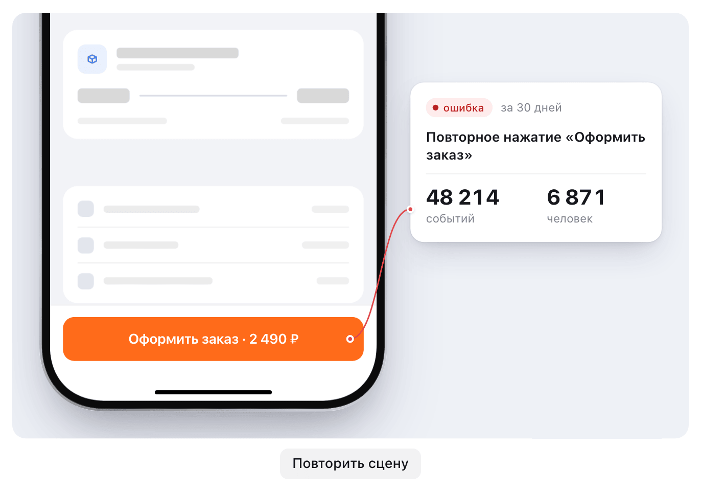

# decision-page

A Claude Code skill that adds an interactive page next to the Claude chat when a chat answer stops being convenient. Short questions stay in the chat. When there are several linked decisions or a lot of evidence, Claude builds a page styled like Claude Desktop. You answer on the page, and Claude reads your answers back.



*The bundled example page at 1280 px. All data on it is made up.*

## Chat or page

| Stays in the chat | Goes to a page |
|---|---|
| one question or clarification | two or more linked decisions |
| a choice between two or three options without long explanations | options whose consequences need to be shown |
| an answer that fits in a couple of paragraphs | evidence: code, data, logs, discussions |
| a status update, a short report | a mechanism that is clearer in motion: a signal passing through layers, a race, UI behavior |
| | a reply to a third person, assembled from your choices |

Typical uses: incident and alert reviews, log and error-tracker investigations, solution design with trade-offs, triaging a request or a thread, planning tasks from findings.

When you have filled in the page, tell Claude in the chat. Claude reads the choices and comments, replies briefly and continues. A new round of the page comes only if several decisions pile up again. Nothing is sent on your behalf: the reply draft on the page can only be copied.

## What a page looks like

The page is built for the Claude Desktop side panel, about 590 px wide. Each screen holds one question: the question as it was asked, the answer first, then up to three key facts and one interactive visual. Details sit one tap deeper. Light and dark themes are both supported.

<p>
  
  
</p>

In a narrow panel, the question menu opens from the top bar, and arrows move between questions. Each item shows the verdict and how many of its decisions are made. Wider than 1000 px, the menu stays on the left, as in the first screenshot.



A decision has mutually exclusive options, each with a one-line consequence. One option is marked as recommended. The engine adds an «Другое» (other) option for a free answer and a comment field, and saves the choice by itself.



The last item is the summary: what you chose, a reply draft assembled from those choices with a copy button, what Claude did not check, and the sources.



When UI behavior is easier to show than to describe, a question can carry an animated scene made with the `stageshow` skill. This is the poster frame of the bundled example: after a survey is closed, the checkout button stops working, and every tap adds an event to the error tracker.



Other visuals in the template: a signal path with "now / after the fix" modes, a situation switcher, a step-through, try-it-yourself queries, bars, a two-column comparison and charts. The catalog is in [references/components.md](references/components.md).

Claude writes the page in the language of the person reading it. The page's built-in UI strings ("Other", "Comment", "Summary" and the like) come in English and Russian. The example is bundled in both languages.

## Install and update

The repository is private for now and used only by its owner. Installing needs read access to it and a git setup that can clone it, for example after `gh auth login`.

```bash
npx skills add karambirov/decision-page -g -a claude-code
```

`-g` installs the skill for all your projects, `-a claude-code` picks Claude Code without a prompt. To update:

```bash
npx skills update decision-page
```

The CLI sends no install telemetry for private repositories. If you want telemetry off for every command anyway, prefix it with `DISABLE_TELEMETRY=1`.

## Requirements

- **Claude Code in the Claude Desktop app or on claude.ai.** This is the full experience: the page is published as an artifact and opens next to the chat, choices are saved in the page's storage, and Claude reads them back. In Claude Code in a terminal, the page stays a local file opened in a browser. Choices are kept in browser storage, and you pass them to Claude with the copy button in the summary.
- **Python 3** for the build script. Only the standard library is used.
- **Optional, for animated scenes:** the `stageshow` skill and Node 20. Install it with `npx skills add benjitaylor/skills`, then run `npm install` in its folder. Without it, pages build without scenes, and Claude uses a step-through or a situation switcher instead.
- **Recommended:** the design and writing skills below. Pages build without them, but new widgets, scenes and texts come out worse.

| Skill | Install | What it adds |
|---|---|---|
| `apple-design`, `emil-design-eng` | `npx skills add emilkowalski/skill` | motion, presses, step-by-step reveal |
| `web-design-guidelines` | `npx skills add ehmo/platform-design-skills` | accessibility, keyboard, responsive layout |
| `redaktura-skills:statya`, `redaktura-skills:redaktura` | Claude Code plugin from `N1arko/redaktura-skills` | structure and editing of Russian text |

The page also uses `artifact-design`, `artifact-capabilities`, `artifact-diagramming` and `dataviz`. They come with Claude Code.

## How it works

Claude writes a content file, not a whole page: the sidebar with the questions, one section per question, a glossary, and a `composeReply` function that turns the choices into the reply draft. `scripts/build.py` merges it with `assets/template.html`, which holds the styles, navigation, widgets and storage. The script checks the markup and writes `page.html` for publishing and `preview.html` for a local browser. Scenes are bundled separately by `scripts/build-scene.mjs` and inlined by the same build.

To build the example yourself, run this from the skill folder and open `preview.html` in a browser:

```bash
python3 scripts/build.py examples/pages/release-cadence.en.content.html --out /tmp/decision-page-example
```

## Repository layout

```
SKILL.md                  instructions for Claude: chat or page, workflow, rules
assets/template.html      page template: Claude Desktop look, navigation, widgets, storage, reply
scripts/build.py          checks a page and assembles it from a content file and the template
scripts/build-scene.mjs   bundles a stageshow scene into one script for embedding
references/               modes, widgets, visuals, language, proposal checklist, decision loop, pitfalls, dependencies
examples/pages/           example content file in English and Russian, made-up data: release cadence and hotfixes
examples/scenes/          example scene: a checkout button that stops working
docs/                     screenshots for this README
```

## License

MIT, see [LICENSE](LICENSE).
